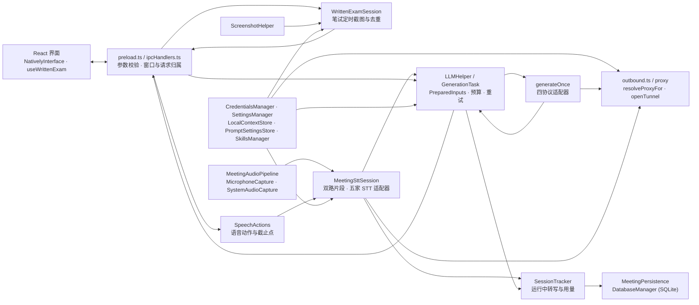
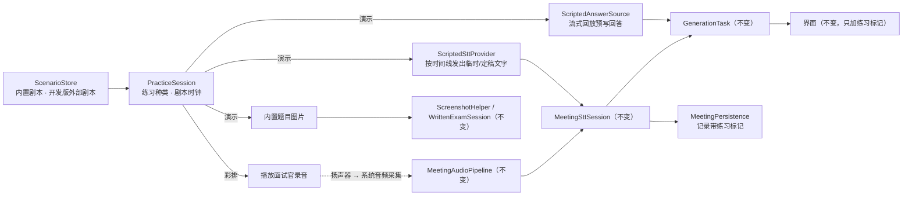

# Margin 架构

Last confirmed: not yet confirmed
Product spec: product.md

Margin 沿用现有结构：Electron 主进程负责业务编排、状态管理与外部通信，React 渲染层负责界面展示与用户交互，Rust 原生模块（`native-module`）在独立工作线程中负责跨平台音频采集与基础窗口能力。以下终态以[产品规格](product.md)为准，并在[2026-10-15 审阅](margin/REVIEW-2026-10-15.md)的基础上补全了网络代理与笔试定时截图两块新增能力 `(proposed)`。

## 目标结构

各核心状态与规则的唯一责任位置如下：

| 状态或规则 | 唯一责任位置 | 对调用方的约束 |
| --- | --- | --- |
| 音频设备占用、释放与健康监测 | `MeetingAudioPipeline`、`MicrophoneCapture`、`SystemAudioCapture` | 主进程按会话生命周期驱动；`monitorCapture` 返回清理函数，在原生采集销毁前解除监测 |
| 双路转写、片段修订与收尾截止 | `MeetingSttSession` | 五家适配器（`SonioxStreamingSTT`、`OpenAIStreamingSTT`、`RestSTT`、`AliyunStreamingSTT`、`DoubaoStreamingSTT`）只上报事件与 `seal` 能力，不各自实现等待策略 |
| 语音动作、口述界标与冻结快照 | `SpeechActions`、`PreparedInputs` | 快捷动作与口述保留各自语义；冻结后迟到片段与已撤回附件或上下文不混入或重放旧请求 |
| 笔试定时截图与去重调度 | `WrittenExamSession`、`ScreenshotHelper` | 主进程定时器防重叠并按 SHA-256 指纹去重；仅持有单个待确认帧，通过 `gemini-chat-stream` 的 `examGeneration` 消费 |
| 生成预算、取消、重试与终态 | `LLMHelper`、`GenerationTask`、`generateOnce`、`ProviderRouter` | 语音快捷动作、口述、文字、手动截图、定时截图与重试共用预算、数据范围与取消规则；`registerGenerationHandler` 与流式入口均受主进程任务约束 |
| 持久配置与运行时应用 | `CredentialsManager`、`SettingsManager`、`ProcessingHelper`、`LocalContextStore`、`PromptSettingsStore`、`SkillsManager` | 持久化成功与运行时应用分离；`ProcessingHelper` 将回答配置应用到 `LLMHelper`，代理与笔试配置分别由 `configureNetworkProxy` 和 `WrittenExamSession` 应用 |
| 出站校验与网络代理路由 | `outboundFetch`、`outboundAxios`、`resolveProxyFor`、`openTunnel`、`streamingStttWsOptions` | 所有出站 `fetch`、`axios` 与 `WebSocket` 统一校验地址、禁止重定向并按同一规则直连或经隧道代理；代理失败不回退直连 |
| 运行中会话记录与会后落盘 | `IntelligenceManager`、`SessionTracker`、`MeetingPersistence`、`DatabaseManager` | `SessionTracker` 收集转写与用量；`MeetingPersistence` 协调清空并区分跳过、成功与失败（失败时保留单份内存待重试或放弃），`DatabaseManager` 使用 SQLite 事务写入 |

### 练习模式的接入

[练习模式](product.md#practice)要求演示和真实会议走同一条全流程，所以模拟只发生在数据来源处：转写服务、回答来源、截图来源和面试官声音。界面、IPC、`MeetingSttSession` 的收尾与冻结、`GenerationTask` 的预算与重试、会议结束与保存全部沿用真实代码，不另写一套演示界面。

| 状态或规则 | 唯一责任位置 | 对调用方的约束 |
| --- | --- | --- |
| 练习种类（演示或彩排）、剧本时钟、与真实会议互斥 | `PracticeSession`（新） | 与现有会话启动走同一个入口和互斥规则；演示跳过采集与权限，方式和笔试会话不采集音频相同 |
| 剧本数据 | `ScenarioStore`（新，只读） | 加载时校验格式；外部剧本只在未打包版本加载，判断规则与现有 `devOverrides.ts` 相同 |
| 演示转写 | `ScriptedSttProvider`（新），实现现有 `ManagedSttProvider` | 由 `MeetingSttSession` 的 `create(channel)` 按会话种类创建；忽略音频输入，实现 `seal()`，所以收尾、冻结和口述范围走真实逻辑 |
| 演示回答 | `ScriptedAnswerSource`（新），`generateOnce` 里一个进程内协议 | 只在演示会话中解析为模型目标，不出现在设置和模型选择里；遵守取消信号，所以首字时限、取消和原输入重试走真实逻辑 |
| 演示截图 | `ScreenshotHelper` 与 `WrittenExamSession` 的截图来源 | 演示时换成剧本图片，与现有截图夹具同一个替换点 |
| 练习记录标记 | `MeetingPersistence`、`DatabaseManager` | 会议表新增一列标记练习；“不保存会议”和保存失败的规则不变 |
| 演示零出站 | 构造保证：演示路径不经过 `outbound.ts` | 用测试断言一整场演示里出站请求数为零 |

**不可逆点**：练习标记是会议表的一次加列迁移（现为 `user_version = 17`，新增一个版本）。旧版本应用读新数据库时会忽略这一列，把练习记录当普通会议显示，不会出错。回退时不删除这一列。

## 方案取舍

- **保留现有进程结构**：继续由 Electron 主进程统一编排音频、转写、代理与模型生成，不增加独立后端进程、插件框架或新的跨层事件总线，原因见[2026-10-15 审阅](margin/REVIEW-2026-10-15.md)。
- **已知结构债 `(proposed)`**：渲染层 `src/components/NativelyInterface.tsx` 仍自行维护一份“是否正在生成”状态（`isProcessing`），与主进程 `GenerationTask` 的生命周期并行；按既有约定，在下次修改回答入口时将其收拢为按主进程 `owner` 与 `requestId` 消费，不单独提前重构。
- **练习模式在哪一层模拟**（2026-11-28 用户确认）：比较了三种做法，选第一种。

  | 做法 | 好处 | 长期代价 |
  | --- | --- | --- |
  | 在数据来源处替换（主进程适配器，上文所述） | 演示和真实会议走同一条代码，演示里看到的就是真实行为；调整界面和收尾逻辑时可以直接用剧本复现；以后能替代测试专用钩子 | 新增两个适配器、一个会话种类和一次数据库加列 |
  | 只在界面层回放 | 最省事 | 绕过收尾、冻结、预算、取消和保存，演示与真实行为会分叉，帮不了调整这些逻辑，也做不到“全流程” |
  | 安装包内置本机模拟服务（复用 `tests/margin/mock-openai.mjs`） | 复用测试代码 | 正式包要开本机端口，要经过出站和代理路径，转写一侧还要再造几种协议的假 WebSocket 服务 |

## 路线

现有的实现、真机验证和发布任务跟随执行计划中的[未完成的 ticket](margin/PLAN.md#未完成的-ticket)。练习模式（2026-11-28 用户确认设计）按下面的顺序推进，每一步都留下能用的系统；实现仍要按 PLAN 另行授权：

1. **面试演示**：`ScenarioStore`、`ScriptedSttProvider`、`ScriptedAnswerSource`、练习会话种类和界面标记，加上会议表的练习标记。验收：不配置任何 Key、不授予任何权限就能从开始会议走到会后回顾；所有面试控件可用；一整场演示出站请求为零；现有门禁全部通过。
2. **笔试演示**：剧本图片接入手动截图和自动捕获。验收：笔试和面试切换、自动捕获、代码输出格式在演示中可用，不截取用户屏幕。
3. **彩排**：播放面试官录音，其余用真实配置；开始前的费用提示和设备检查。验收：在一台真机上用真实服务走完全流程，记录服务、次数和费用（按 PLAN R7 逐次授权）。
4. **测试收拢（可选）**：回答回归测试改用剧本播放器，逐步删除只为测试存在的 `test-inject-transcript` 和 `MARGIN_DEV_*` 钩子，删除时按 PLAN R22 写明替代测试。

## 待决事项

仅列会直接影响系统结构或交付形态的未决问题，详见[产品规格的 Open questions](product.md#open-questions)及[执行计划未完成的 ticket](margin/PLAN.md#未完成的-ticket)：

- **AG-62（正式 Margin 身份）**：决定何时放开“正式身份仅限 CI 运行”的守卫以及本机数据目录切换，阻塞正式身份构建与本地运行验证。
- **AG-74（正式发布工作流与签名 D6）**：尚未确定正式发布目标仓库、发布工作流及签名公证方案，阻塞自动化发布流水线与最终安装包形态。
- **练习模式的剩余决定**：剧本内容、练习记录去留、彩排录音的播放方式，见[产品规格的 Open questions](product.md#open-questions)。剧本内容阻塞上面路线的第 1–3 步，记录去留阻塞第 1 步的保存行为，录音播放方式阻塞第 3 步。
