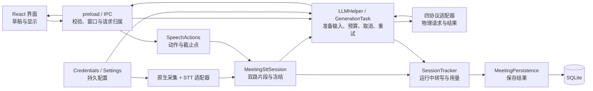

# Margin 工作方向与接手审阅 · 2026-10-15

审阅日期：2026-10-15（Europe/Berlin）。代码基线：`eddba6b88b0b8760b723ba6e65ce11271d382ebf`，分支 `codex/margin-agpl-migration`。

主审使用 system-blueprint 与 product-spec 核对产品终态、架构和推进顺序；另两位独立 `gpt-6-astra / medium` 分别审阅高内聚、低耦合与奥卡姆剃刀。三方均基于当前分支做只读分析，主审复核关键调用链并整合结论。本次改动仅为文档。

本文是一次有日期的审阅和接手说明。当前产品要求仍由 [产品规格](../product.md) 管理，执行与决定在 [PLAN](PLAN.md)，最新进度在 [Wayfinder](../wayfinder.md)。下文的改进路线均为 `(proposed)`，不代替既有决定，也不表示发现的问题已经修复。

## 后续状态（2026-10-15，用户确认）

本次首次启动等待已标为**已解决**：系统日志确认麦克风重新授权约 67.8 秒、钥匙串授权约 81.9 秒；后续实际启动不足一秒，满足用户允许首次授权等待的标准。另一个 `Application quit` 问题已在 `cfa34705` 修复并安装，实际退出已核对。证据见 [安装与授权诊断](evidence/S45/native-quit/installation/README.md)。同步原生初始化的结构未被重构；下文相关内容保留为审阅时分析，不再作为本次未关闭阻塞。

剩余：1 项明确缺陷（会议保存失败），3 项结构风险（配置应用、音频监测清理、生成入口协调），4 项清理候选（依赖别名、旧脚手架、未接线压缩模块、动作包装重复）。真实服务/设备与共享验收、正式身份和平台发布仍单独管理。优先处理保存失败，其余建议不自动升级为发布前重构要求。

## 后续状态（2026-10-20）

上面"剩余"清单的处理结果如下。每项都经本地完整门禁和公开 CI，各自的记录见 PLAN §8。

| 项目 | 状态 | 提交与证据 |
| --- | --- | --- |
| 明确缺陷：会议保存失败 | **已关闭**。保存失败时会议留在内存，可重试或确认放弃；开始新会议会被拒绝 | `506bf492`、`dbc6b2dc`，公开 CI 38992504973；[记录](evidence/meeting-save/README.md) |
| 结构风险：音频监测清理 | **已关闭**。`monitorCapture` 返回清理函数，管线在原生销毁前调用 | `fb08324a`；[记录](evidence/audio-monitor-cleanup/README.md) |
| 结构风险：配置应用 | **已关闭**。回答服务只用软件里保存的 Key；启动和保存共用应用操作；旧的单服务 Key 入口已删除 | `aff0c66e`、`00dbfb17`，公开 CI 39125836864；[记录](evidence/answer-config/README.md) |
| 结构风险：生成入口协调 | **部分完成**。9 个生成频道改为 `registerGenerationHandler` 显式注册，行为不变。文字流、重试、截图路径未整理，按原建议在下次修改入口时再整理。另已完成跨入口取消与迟到输出验证：主进程 4 个场景加 preload 两个方向，均通过，生产代码未改 | `8fc6ff14`，公开 CI 39391240062；[记录](evidence/generation-registration/README.md)；[交叉验证](evidence/cross-entry-cancel/README.md) |
| 4 项清理候选 | **3 项已处理（2026-10-22）**：删除 `react-query` 别名、`renderer/` 脚手架和未接线的 `ConversationSummarizer.ts`。`ClarifyLLM` 重复代码按原建议留到下次修改该动作时再整理 | `faa4da27`，公开 CI 39801535976；[记录](evidence/cleanup-20261022/README.md) |

不在原清单内、另经用户批准完成的：删除日历的数据库残留（`7cccf381`，与保存失败一起交付）。

以上都是代码和隔离测试层面的结果。写这一段时本机还是 S45 版本；之后已安装包含上述修复的 Natively Local `44a5e3a8`（2026-10-21，[安装记录](evidence/local-install-20261021/README.md)），2026-10-22 又安装了含设置改版的 `9ea320d6`。2026-10-22 的无消费者清理（`faa4da27`）不改应用行为，没有另装。真实服务/设备验证和阶段 6 签收（下面第 3 项）尚未开始，现在是主线的下一步，按[阶段 6 实机复测清单](STAGE6-CHECKLIST.md)执行。

## 结论与接手顺序

工作方向可以继续：围绕笔试练习和面试交流，做用户主动触发的截图、语音、文字回答；先交付 macOS arm64，再完成 Windows x64。现有删减已显著收窄产品，不宜继续扩大功能或启动全面重构。接下来的主要问题是：真实机器能否稳定启动、失败是否如实反馈，以及现有核心链路在真实服务中是否可用。

接手时按下面顺序处理：

1. **已关闭**：S45 首次授权等待和退出后残留进程，依据上述后续诊断、实际启动/退出验证及用户确认，不仅依据隔离测试。
2. **已关闭（2026-10-17）**：修复会议保存失败被当成正常结束的问题。先保证错误可见，再明确失败数据的保留或放弃方式。
3. **下一步**：在既有授权范围内完成所选模型、语音服务与共享接收端的真实验证；记录实际版本和结果，完成阶段 6 用户签收。执行前先确定测试组合（D2），并安装包含上述修复的新版。
4. **大部分完成（2026-10-20）**：配置、生成入口和音频边界的整理随相关改动实施；无调用残留单独清理，不抢占前三项。配置和音频已完成，生成入口只做了显式注册，清理候选未处理。
5. 按 PLAN 处理正式 Margin 身份、Mac 发布，再进入 Windows。旧 `windows-support` 分支仍受来源边界约束，不能直接合并。

这些是优先级建议，不新增真实服务费用、设备测试或发布授权。

## 远端进展与证据

本轮已抓取 `origin`。本地最初位于 `codex/ai-assistant-refactor`，工作区没有已跟踪文件改动；随后切到最新工作分支。分支切换后浮现的本机 `bench-project.json` 未修改、未纳入提交。

| 入口 | 抓取时的状态 | 接手含义 |
| --- | --- | --- |
| `origin/main` | `e045661d`，2026-09-22 | 不是当前开发基线 |
| `origin/codex/ai-assistant-refactor` | `36af1111`，2026-10-10 | 旧工作线，不能据此判断现在的功能 |
| `origin/codex/margin-agpl-migration` | `eddba6b8`，2026-10-15 | 本次审阅与文档交付分支 |
| 公开仓库 `xbz123/margin` 的同名分支 | 读取远端时同为 `eddba6b8` | 用于核对已有公开 CI；本报告推送目标为当前项目的 `origin` |

近几轮已经完成的工作包括：手动语音动作冻结、原输入重试与可见首字计时、设置双语与引导、窗口控制、S44 模型发现与退出修复，以及 S45 官方服务与独立网关配置。S45 允许用户从空配置手动重新填写，已经撤销旧配置迁移兼容要求；安全存储、地址绑定和保存失败保护仍保留。

S45 实现为 `dd3eb703`，来源登记修正为 `1bcd8ea0`。[公开 CI 38657160310](https://github.com/xbz123/margin/actions/runs/38657160310) 的在线状态已核对为 `completed / success`，其提交为 `1bcd8ea07795e5b5727fb6c2e71831331932fba8`。本轮比较该提交与审阅基线，应用、测试、脚本、依赖、原生源码和 workflow 没有差异。

本轮读取 [S45 final-gates 汇总](evidence/S45/final-gates/summary.json) 及 [逐文件测试结果](evidence/S45/final-gates/tests.files.json)，核对到 16/16 门禁、133 个测试文件、1187/1187 用例、零失败且全部结束。该本地报告的 `head` 是修改前的 `dca94aef`，同时记录了未提交改动，不能把它单独当成干净提交的证明；后续精确提交的 CI 与代码树比较补足了这个边界。[S45 回执](evidence/S45/README.md) 另记录回答 21/21、存储 2/2、启动 1/1、挂载界面 13/13。

S45 同源本机测试包已经安装：回执记录包检查 12/12、隔离 asar 启动 10/10。真实进程启动后，自动窗口读取超时，用户正在测试。这里不能写成“真实界面启动通过”，也不能把超时直接归因为 CoreAudio；S44 的 CoreAudio 阻塞有独立采样证据，S45 超时的原因尚未确定。

软件验收、安装验证和用户签收是不同结果。真实语音采集、模型兼容性、回答质量、端到端速度及共享接收端不可见，仍没有被这些模拟测试证明。恢复入口是 [S45 安装记录](evidence/S45/README.md#user-authorized-local-installation-2026-10-15) 和 [阶段 6 签收标准](PLAN.md#阶段-6-验收标准与当前结果)。

## 主审：产品方向与架构终态

### 产品范围已经足够明确

[产品规格](../product.md) 已经分清三种入口：快捷动作使用点击前的双方转写；Answer / Stop 使用本次口述；文字提交直接发送。这三者服务不同操作，不应为了代码统一而合并。四种回答协议、五家 STT、独立网关、数据范围控制和撤回，也都是已确认范围。自动回答、Judge、RAG、预热、自动摘要等已经退役，不再列作“下一步可删功能”。

当前应把“完成更多票”换成可观察的交付结果：用户能启动、完成一次真实问答、停止或取消、理解失败，并在需要时找到会议转写。10 秒首字、60/180 秒总时限是执行预算，不是已测得的速度保证。语音收尾最多可占 3.75 秒，因此不能只测模型网络耗时就宣称满足面试体验；要从点击/Stop 到首个可见回答文字测量。样本及 P50/P95 达标线仍由 D2 决定。

规格的 `Last confirmed: not yet confirmed` 指整份提取稿未整体确认，不撤销已有单项决定。接手者只需确认仍列于 Open questions 的事项；不应重开已定的 D7、D8、D9。

### 保留现有进程结构，明确状态归属

当前没有独立的 `docs/architecture.md`，但 PLAN 已有模块地图和边界决定。本次用下表说明建议的终态，不另建竞争性的产品或架构规范。若后续批准改变边界，应在现有权威记录中更新一次。



这是责任示意图，不表示所有边界已经完成整理。建议继续采用 Electron 主进程编排、React 显示、原生音频实现的现有结构，不增加独立后端、插件框架或新的总线。

| 状态或规则 | 应有的唯一责任位置 | 对调用方的约束 |
| --- | --- | --- |
| 设备占用、释放、重建 | `MeetingAudioPipeline` 与原生采集适配层 | 主进程调用明确生命周期；健康监测返回明确清理句柄 |
| 会话、通道、连接代次、片段修订、收尾截止 | `MeetingSttSession` | 五家 STT 只报告协议能力与事件，不各写一套业务等待策略 |
| 一次用户动作及冻结输入 | `SpeechActions`、现有 `PreparedInputs` | 保留三入口语义；新片段和已撤回内容不混入旧请求 |
| 生成预算、取消、发送次数和终态 | `GenerationTask` 及现有生成入口 | 手动动作、文字、截图和重试共享这些规则，渲染层只按 owner/request 消费 |
| 持久凭据与运行配置 | `CredentialsManager` / `SettingsManager` 保存事实，`LLMHelper` 应用运行快照 | 保存成功与运行应用成功分开；启动与修改后应用使用相同规则 |
| 运行中的会话记录 | `SessionTracker` | 收集转写与用量；清空时机与保存结果协调，不与生成重试快照混用 |
| 会后记录与保存结果 | `MeetingPersistence` + SQLite 事务 | 主动不保存、保存成功、保存失败必须可区分 |

### 原审阅的启动风险（本次事件已关闭）

以下是审阅基线的结构分析；当前事件的原因和关闭依据见本文后续状态，不表示已经实施下面的架构建议。

证据链为 [`MicrophoneCapture.ts:7`](../../electron/audio/MicrophoneCapture.ts#L7)、[`SystemAudioCapture.ts:6`](../../electron/audio/SystemAudioCapture.ts#L6) 顶层调用 loader；[`nativeModuleLoader.ts:96`](../../electron/audio/nativeModuleLoader.ts#L96) 用同步 `getInputDevices()` 做功能探测；Rust [`microphone.rs:22`](../../native-module/src/microphone.rs#L22) 进入真实设备枚举。[S44 回执](evidence/S44/README.md#user-reported-connection-failure-and-follow-up) 中的启动采样也记录了枚举进入 CoreAudio 后未到 app-ready。

已证实的是启动路径与真实设备探测耦合，以及 S44 确有阻塞记录；导致操作系统调用阻塞的具体条件尚未查明。外层 Promise 或 JavaScript 定时器不能解除同一主线程内已经阻塞的同步原生调用。

建议 `(proposed)`：先复现并保留窄采样，把模块加载/ABI 验证与设备就绪检查分开，使音频失败不会阻止设置、文字和截图入口启动。不得直接删除真实 ABI 检查来让测试变绿：可将其保留在包验证路径，运行时通过明确的音频初始化结果报告失败。若设备调用仍可无限挂起，再根据复现选择原生异步任务或可终止的辅助进程；前者边界较小，但不提供强制终止挂起调用的保证，后者能隔离故障但增加 IPC 与退出管理。此选择留给故障复现结果，不先引入通用多进程框架。

验收应覆盖设备探测不返回/失败时界面仍可操作、文字与截图仍可用、音频入口给出明确失败，以及正常设备初始化与退出没有回归。真实设备验证不能由一次 mock 延迟替代。

## Astra 一：高内聚、低耦合

这位评审认可 `MeetingSttSession`、`SpeechActions`、`GenerationTask` 和 `PreparedInputs` 的边界。它们隐藏了真实的协议、预算和生命周期复杂性；大文件本身不是拆分理由。发现如下，第一项是静态确认的缺陷，其余是设计风险。

### 1. 保存失败被折叠成正常结束，应优先修复

[`MeetingPersistence.ts:56–88`](../../electron/MeetingPersistence.ts#L56-L88) 先复制数据、再 `session.reset()`，随后保存数据库；捕获写入异常后只返回 `null`。数据库本身会抛错（[`DatabaseManager.ts:499–504`](../../electron/db/DatabaseManager.ts#L499-L504)），但 [`main.ts:1607`](../../electron/main.ts#L1607) 忽略了持久化返回值，最终 [`ipcHandlers.ts:1791–1797`](../../electron/ipcHandlers.ts#L1791-L1797) 可返回 `success: true`。

因此，在本应保存的会议遇到数据库错误时，当前会话已清空、没有新记录，而结束请求表现为成功。现有 [`MeetingPersistence.test.mjs:74–85`](../../electron/services/__tests__/MeetingPersistence.test.mjs#L74-L85) 还把保存失败与主动不保存放在同组，断言都会 reset；测试通过不能证明该行为符合产品预期。

建议 `(proposed)`：区分保存成功、主动丢弃和保存失败，并把失败传到用户可见的结束结果。默认建议成功后释放待保存内容，失败时仅在现有生命周期中保留有界内存数据，直到重试或明确放弃；新会议会再次 reset，不能只移动一行就宣称恢复完整。具体失败后交互需要确认，不恢复跨重启任务、自动摘要或旧增量存档。即使最终接受“尽力保存、失败可丢弃”，也应准确提示失败。

验收：沿真实持久化→结束会议→IPC 链注入数据库异常，断言没有成功回执、错误可见、数据不会在不知情时被覆盖；主动不保存仍零落盘，正常保存只写一次。

### 2. 配置保存与启动恢复分散，随下一次配置改动收拢

启动加载在 [`ProcessingHelper.ts:48–97`](../../electron/ProcessingHelper.ts#L48-L97)，保存官方配置、网关及删除网关在 [`ipcHandlers.ts:1067–1106`](../../electron/ipcHandlers.ts#L1067-L1106)，运行客户端重建在 [`LLMHelper.ts:399–430`](../../electron/LLMHelper.ts#L399-L430)。开发者添加一个字段时，需要同步理解多处应用顺序。

目前没有证据证明某个已实现字段丢失。建议 `(proposed)` 在下一次触及配置时，让启动和保存共同调用现有层上的“应用已保存回答配置”操作，保留保存失败与应用 warning 的区别，不新增配置框架，也不强行合并 STT 设置。用同一配置比较立即请求、模拟重启后请求、原输入重试的目标与参数；保存失败不得改变运行配置。若配置稳定、等价性覆盖充分，可以延期。

### 3. 音频监测清理依赖隐式属性，进入 Windows 前明确契约

[`MeetingAudioPipeline.ts:14`](../../electron/audio/MeetingAudioPipeline.ts#L14) 声明 `monitorCapture(...): void`，主进程却给 capture 挂上 `__disarmStuckWatchdog`（[`main.ts:1031`](../../electron/main.ts#L1031)、[1142](../../electron/main.ts#L1142)），管线销毁时再通过类型断言调用它（[`MeetingAudioPipeline.ts:100–105`](../../electron/audio/MeetingAudioPipeline.ts#L100-L105)）。停止前先解除监测的必要顺序藏在接口之外。

建议 `(proposed)` 让既有监测回调返回清理函数，由管线保存并在 native destroy 前调用。保持当前阈值和平台诊断，不借机重写健康检测。停止、初始化中止、设备重建都要验证清理顺序；native destroy 延迟时也不能会后误报。当前双方已经配合，不能把这项结构风险写成已经复现的 race。

### 4. 生成入口仍需手工协调多个协议，修改入口时再整理

[`ipcHandlers.ts:108–143`](../../electron/ipcHandlers.ts#L108-L143) 的通用包装按动作名单处理冻结、任务和可见回执；文字流、重试另有路径；[`main.ts:1624`](../../electron/main.ts#L1624) 与 [`preload.ts:539`](../../electron/preload.ts#L539) 还管理请求归属和消费状态。新增入口容易遗漏取消、迟到事件或终态处理，目前未发现可以确认的串答缺陷。

建议 `(proposed)` 在下一次入口改动时，先明确命名回答入口的注册与生命周期契约，复用现有任务和显示逻辑。用快捷动作→文字→重试/取消的交叉序列验证：旧 token 和旧终态不能改变新行，可见回执绑定正确请求，准备失败不提供原输入重试。保留用户可见的三入口，不造万能命令或事件总线。

## Astra 二：奥卡姆剃刀

简化的判据是减少理解、变更和维护成本，同时保留已承诺行为。以下候选优先级低于真实启动和保存失败；本轮没有删除它们。

| 候选 | 证据与实际成本 | 最小后续动作及保留边界 |
| --- | --- | --- |
| 无效 `react-query` 别名 | [`package.json:197`](../../package.json#L197) 已有实际使用的 TanStack Query，[:221](../../package.json#L221) 又声明异常别名；[`collect-licenses.mjs:257–261`](../../scripts/margin/collect-licenses.mjs#L257-L261) 为它保留 dangling alias 特例 | 单独依赖维护票，核实消费者后只移除别名及其失去用途的 lock 条目/特例；不顺带升级依赖。验证干净安装、构建与许可清单 |
| 第二套默认前端脚手架 | [`renderer/package.json`](../../renderer/package.json)、[`renderer/src/App.tsx`](../../renderer/src/App.tsx) 仍为独立 CRA 示例；当前入口是 [`index.html:23`](../../index.html#L23) 的 `src/main.tsx` | 最终核对全仓、动态路径及外部构建入口后删除无消费者脚手架。当前没有运行负担证据，不宣称删除会提速应用 |
| 未接线的会话压缩模块 | [`ConversationSummarizer.ts`](../../electron/llm/ConversationSummarizer.ts) 的导出在 `electron/src/scripts/tests` 检索中只见专属测试消费 | 确认构建及动态导入后成对移除模块与专属测试；保留 [`SessionTracker.ts:653`](../../electron/SessionTracker.ts#L653) 起真正使用的长会话压缩与截断 |
| 薄动作包装重复 | [`ClarifyLLM.ts`](../../electron/llm/ClarifyLLM.ts) 的流式/非流式路径重复部分提示词和准备步骤 | 修改该动作时局部复用，不现在全局抽象。保留发送前校验、冻结输入、取消、协议完成判断及共享预算 |

反向约束同样明确：不能因为文件多就合并发送、任务、快照三层；不能因为测试多就删隔离、来源检查或真实 IPC/界面测试；`sharp` 在当前分支仍用于开发期图标生成（[`generate.mjs:10`](../../scripts/icons/generate.mjs#L10)），不应误报为可以再次整包移除的运行时残留。若发现外部构建或动态消费者，上述删除候选需要重新判断。

文档的实际问题是多个“当前”指针不一致：审阅基线的 PLAN 顶部仍写 S44，Wayfinder 和 PLAN 内部已到 S45。本次已把 PLAN 顶部改为当前进度入口，并从 README、Wayfinder 链到本文。历史失败记录继续保留；证据多本身不是问题，不再复制一套长期维护的规格。

## 建议路线、完成证据与待决事项

| 顺序 | 可独立完成的结果 `(proposed)` | 验收证据 | 兼容与恢复考虑 |
| --- | --- | --- | --- |
| A：关闭当前失败 | S45 实际启动可重复；会议保存失败不冒充成功 | CoreAudio 窄复现及修复前后结果；真实持久化链的故障注入 | 不改用户权限或旧数据；不引入持久恢复库；音频改动可独立回退 |
| B：完成 Mac 用户签收 | 已选核心场景在真实设备/服务中可用 | 从触发到可见首字；取消与重试；采集、设备切换；共享接收端无窗口也无黑框 | 组合、样本和费用按 D2；未经验证的组合仍不宣称支持 |
| C：随变更明确边界 | 配置应用、音频清理、回答入口各有明确责任 | 保存/重启/重试一致；清理顺序；跨入口取消与迟到事件 | 分开提交，沿既有接口逐步替换，不一次搬走 main/IPC |
| D：Mac 发布后推进 Windows | 已批准平台包、对应源码与说明可核对，再做 Windows x64 | 既有包检查、原生架构、源码对应；Windows 编译和实机验收 | 正式身份和每次发布单独决定；不直接合并旧 Windows 线，不做未批准的数据迁移 |

A、B 是主线；C 的局部整理和残留清理仅在帮助当前问题或后续平台工作时插入，不成为额外发布前大重构。产品范围与平台顺序继续遵循原决定。

仍需具体决定的是：D2 的真实验证组合与预算、正式身份和发布时机、最终图标，以及保存失败后的交互策略。D6 签名/公证已决定后续处理；它阻塞签名版发布，不应被写成所有开发和首次未签名发布的共同前提。线程还是辅助进程的音频隔离选择，要等挂起复现证据。

## 朋友接手时的操作入口

先确认自己的工作区状态，再切换到本工作线；不要把旧 main 当成最新版本，也不要用 reset 覆盖个人改动。

```sh
git status --short --branch
git fetch origin
# 本地尚无此分支时：
git switch --track origin/codex/margin-agpl-migration
# 本地已有此分支时：
# git switch codex/margin-agpl-migration
# git pull --ff-only
```

阅读顺序：本报告 → [Wayfinder](../wayfinder.md) → [产品规格](../product.md) → [S45 回执](evidence/S45/README.md) → [阶段 6 签收标准](PLAN.md#阶段-6-验收标准与当前结果)。需要修改代码时，再读对应 PLAN 票、[贡献说明](../../CONTRIBUTING.md) 和 [来源规则](PROVENANCE.md)。

**两个仓库的分工（2026-10-20 起）**：私有仓库 `origin` 的 `codex/margin-agpl-migration` 保存完整历史，包括 PLAN、Wayfinder、PROVENANCE 和验收记录，按上面的命令拉取即可得到最新版本。公开仓库 `xbz123/margin` 的同名分支暂时只接收代码、测试、脚本和门禁需要的配置（如 `provenance-config.json`），文档更新不推送到公开仓库。公开提交在公开代码工作树里单独生成，确认代码与私有提交逐字节一致后再推送；需要 CI 时在提交说明里加 `[gates]`。公开分支的提交号与私有分支不同，对应关系记在各票的验收记录里。

来源核查：CI 每次都会重新拉取上游引用，本机的上游引用池可能较旧。本地来源检查 0 命中，不代表公开 CI 也能通过。CI 标记旧代码里的通用语句时，逐条核对上下文，确认是通用写法后在 `provenance-config.json` 按原文精确登记，不排除路径或引用池；以公开 CI 的结果为准。

改代码后继续使用既有隔离 runner 和 `run-gates.mjs`，按现行票据规则取得精确代码的 CI；不新增平行验收框架。本文这类纯文档提交不重跑相同应用代码的测试。不得将本报告中的建议当成已经批准的实现票。

本轮实际核对了远端分支、CI 在线终态、S45 存档计数、应用/测试树差异、关键源码和调用者、现有测试断言及文档链接。两位 Astra 的结果均经主审筛选，保存失败链和启动同步枚举链已进一步核对。没有重新构建、运行应用测试、连接真实模型或采集设备；没有发布、修改权限或读取真实凭据。报告不构成新的实机签收或完整安全审计。
