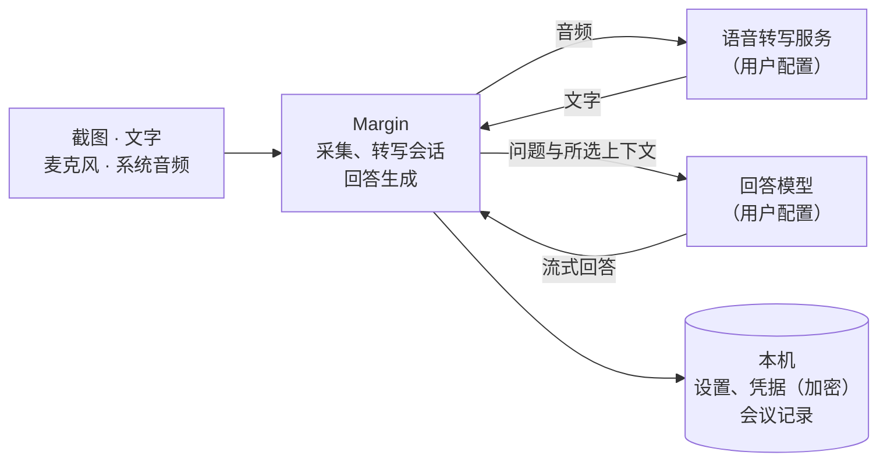
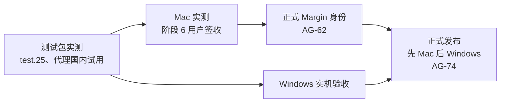

# Margin 总览

本页是给人看的简介，五分钟读完。内容都来自[产品规格](product.md)和 [PLAN](margin/PLAN.md)；两者有出入时以它们为准，系统结构看[架构](architecture.md)，进度看 [Wayfinder](wayfinder.md)。

## 它是什么

Margin 是一款桌面辅助应用，帮软件工程师做笔试练习和面试交流。用户用截图、语音或文字提问，Margin 调用用户自己配置的模型服务生成回答；面试时先给能马上开口的内容，再展开。会后可以在本机回看转写和问答记录。

支持 Apple M 系列芯片的 Mac 和 Windows 10/11 x64。代码基于已记录的 AGPL 基线重建，作品许可为 `AGPL-3.0-only`。

## 怎么工作

- **笔试**：截图或文字提问，也可以开启定时截图自动解答。编程题给完整可提交代码，再给思路。
- **面试**：同时转写麦克风和系统音频。回答只由用户触发：What to answer 等快捷动作用点击前的双方转写；Answer / Stop 用两次点击之间的口述；文字发送直接用输入的内容。
- **数据去向**：音频只发给所选的转写服务，回答请求只发给所选的主模型或用户设置的备用模型。转写、截图、历史回答能否外发可以分别关闭。没配置的服务收不到任何数据。
- **网络**（细则待逐条确认）：外部服务按设置走代理，阿里云、豆包语音、DeepSeek 以及本机和私有 IP 地址始终直连。
- **窗口保护**：在 Chrome、Zoom、腾讯会议、飞书中整屏共享时，对方看不到 Margin 的窗口。
- **练习**（设计已确认，尚未实现）：Margin 扮演面试官，从开始会议到会后回顾完整走一遍。“演示”不用任何配置，转写和回答来自内置剧本；“彩排”只模拟面试官，其余用自己的真实配置，在真面试前检查设备和服务。

## 做什么，不做什么

会做的事情，详细条款见[规格的 Expectations](product.md#expectations)。

不做的事情包括：面试自动回答、联网搜索、OCR、本地语音转写、遥测、自动更新、会议自动摘要和标题、跨重启恢复，以及“进程不可检测”这类承诺。完整列表见 [Non-goals](product.md#non-goals)。

## 路线

现在所有开发都在主线 `main` 上，用 `temp` 身份的测试包交付，还没有正式发布。签名和公证没有购买，首次发布可以是未签名版本，下载者会看到系统警告。路线没有日期，每一步都要用户决定或签收。

## 需要读者决定的事

摘自[规格的 Open questions](product.md#open-questions)：

- 真实服务验收的测试组合、样本数、费用和达标线（D2）。
- 签名和公证的方案与时间（D6）。
- 图标的具体图形。
- “减少永久需要输入的内容”具体指哪些设置项。
- 正式 Margin 身份何时启用，每次发布的授权（AG-62）。
- Windows 10 的最低版本和实机测试组合。
- 练习模式的内置剧本内容、练习记录是否保留、彩排录音怎么播放。
