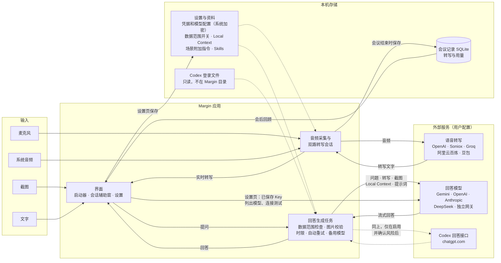
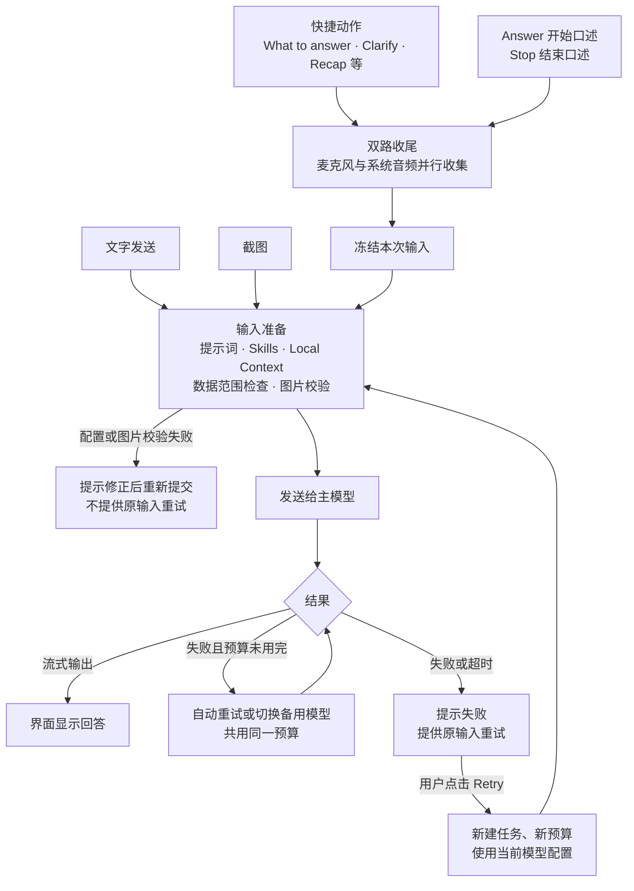
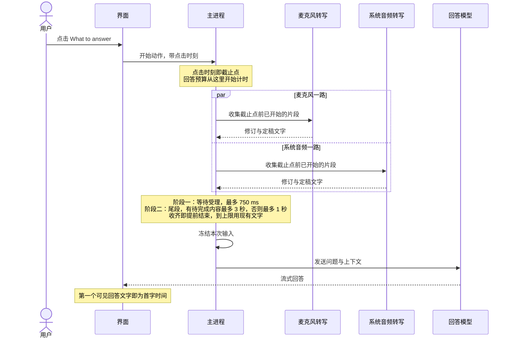
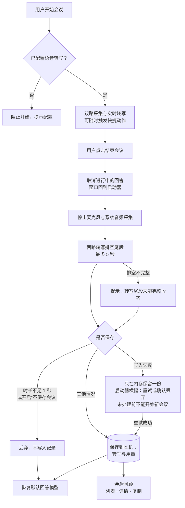

# Margin 产品规格

Last confirmed: not yet confirmed

本文件是 Margin 当前产品需求的唯一入口：写的是产品“应该是什么样”，不是实现进度。“not yet confirmed” 只表示整份文档在拆分和改写后还没有经用户整体确认，不撤销各条款原有的批准；用户尚未确认的新主张标为 `(proposed)`。

- 执行计划、授权边界、历史决定与验收记录在 [PLAN](margin/PLAN.md)；当前进度与恢复入口在 [Wayfinder](wayfinder.md)。
- 产品行为以本文件为准。本文件不授权运行真实服务、实机测试、发布或阶段签收。
- 条目后的编号（如 AG-42、U3、S44）指向 PLAN 中的原始决定或票据，便于追溯。

## Purpose

Margin 是一款桌面辅助应用，服务两个场景：**笔试练习**和**软件开发工程师面试交流**。

- 用户用截图、语音或文字提问，Margin 调用用户自己配置的模型服务生成回答。
- 面试中，先给出能马上开口的相关内容，再展开。
- 面试默认提示使用独立编写的精简英文规则，覆盖基础知识、项目与行为问题、系统设计、编程和调试，不附加销售、谈判或通用会议规则；回答语言仍遵循用户明确要求和软件设置。转写明显错字结合上下文理解，关键歧义允许说明假设或针对性澄清；不虚构经历、指标或已执行的验证。笔试提示不随面试精简而变化。
- 会后，用户可以在本机回看已采集的双方转写。

Margin 基于已记录的 AGPL 基线重建：先交付 macOS，再实现、验收和发布 Windows，最后核对共享代码与平台差异后统一分支。

## 总览

下图展示输入从哪里来、应用由哪几部分组成、哪些数据存在本机，以及每类数据会发往哪些外部服务。外部服务都需要用户自己配置并提供凭据；没有配置的服务不会收到数据。

- 音频只发给所选的语音转写服务；回答请求只发给所选的主模型，失败时才可能发给用户明确设置的备用模型。
- 转写、截图和历史回答能否发给模型，由设置里的数据范围开关决定；关闭的类型不会进入请求。
- 设置页的模型列表和连接测试只使用已保存的 Key；语音连接测试只发送合成的测试音频，不发送真实录音。
- 精确的出站地址、重试次数和失败类型见 [OUTBOUND](margin/OUTBOUND.md#application-http)。

## Expectations

### 截图、文字与回答显示

来源：AG-31、33、34，S34。

- 用户可以截图提问、打字提问，也可以使用笔试模式；回答流式显示，可以随时取消。
- 回答支持四种协议：Gemini、OpenAI Chat、OpenAI Responses、Anthropic Messages。官方服务商为 Gemini、OpenAI、Anthropic、DeepSeek；兼容网关是独立来源，不覆盖官方服务商。Groq 不出现在回答模型选择和配置入口，语音转写中的 Groq 不受影响。
- Codex 登录是独立的只读凭据来源，不保证自动获得账号权益，也不保证与真实服务兼容；边界见 [OUTBOUND](margin/OUTBOUND.md#codex-file-login-source-ag-34-local-verification)。
- 本阶段只要求单个显示器内的全屏或选区截图及输出（用户 2026-10-23 确认）；可选目标显示器，但不要求跨显示器拼接。单屏截图按原图分辨率发送，不再缩小到 1536 px；编码为 JPEG（质量 80）。图片校验只接受 PNG/JPG，不接受 WebP/GIF。截图是否保持屏幕原生像素密度，仍需在真实屏幕上确认。
- 笔试场景（手动选“笔试”，或“自动”下实际按笔试发送的文字/截图提交）中用户发出的消息用随深浅主题变化的中性色消息框、细边框和小文本消息图标，与无外框的模型回复区分；样式按消息发出时的实际场景决定，之后切换下拉框不改变历史消息。面试消息、其他页面和全局强调色不变（S46-02，用户 2026-10-22 确认）。

### U1 · 核心场景与会后回顾

来源：AG-33、42、51、52。

- 核心场景是笔试练习和面试实时辅助。截图和语音是主要输入，文字发送保留。
- 会后回顾只是辅助功能，内容是已采集的双方转写：本地会议列表、详情和复制（沿用 S33 的缩减范围）。
- 不恢复会前设置、自动摘要、标题生成、启动恢复、会议聊天，也不恢复旧版的完整增量保存设计。

### U2 · 手动回答入口

来源：AG-42。

面试回答只由用户主动触发，不恢复面试自动回答/Judge。笔试定时截图解答是用户明确开启后的例外，见 S50；三种手动入口用途不同，不合并：

| 入口 | 用户操作 | 用什么作为问题 |
| --- | --- | --- |
| What to answer 等快捷动作 | 点击按钮或按快捷键 | 点击时刻之前的双方转写；What to answer 以面试官最近的几段话（含正在说的那句）为问题并显示出来 |
| Answer / Stop | Answer 开始口述，Stop 结束口述 | 两次点击之间用户口述的内容；没有口述时见下 |
| 文字发送 | 输入文字后提交 | 输入的文字，不等待转写 |

- Clarify、Brainstorm、Recap、Follow Up Question 保留各自的功能；不恢复面试自动回答和 Judge。
- 面试快捷动作和 Stop 都走同一套双路收尾（见 [U3](#u3)、[U4](#u4)）。顶部的结束会议按钮走独立的会议结束流程（见[会议与本地记录](#meeting)）。
- 已有的取消与任务隔离保留。“发新消息会取消旧生成”需要按真实入口核对，不能当作现成保证。
- **Answer / Stop 的口述范围**（2026-11-11 至 11-12，用户要求参照旧 Margin；[记录](margin/evidence/answer-dictation/README.md)）：
  - 按下 Answer 只记录时刻，不动转写连接。按下前已经开口、还没定稿的那句，之后被修订或定稿时整句纳入；按下前 5 秒内更新过的未定稿句子同样纳入。
  - 按下前已空闲超过 5 秒、按下后只是被定稿或加标点的句子不算这一轮。被更早一次动作结束的请求里的话也不算，即使结果迟到。
  - 已知边界：服务商把新话接在一句空闲的旧话后面、作为同一句返回时，整句进入问题。
- **Stop 时没有口述**（2026-11-12 用户确认“按最小改法”）：没有附件、麦克风一路没有口述，而面试官一路在“按下 Answer 前 15 秒”到 Stop 之间说过话时，用这次 Stop 冻结的同一份内容按 What to answer 的方式作答，不重新收集；否则仍提示未检测到语音。
- **再次按下**（2026-11-12 用户确认）：再按 Answer 或 Stop 即开启新问题。上一轮还在收尾时再按 Answer，上一轮照常出问题和回答；之后的 Stop 取代上一轮，正在输出的回答被截断。

下图是一次回答从触发到显示的路径。

### U8 · 回答内容与真实性

来源：AG-51。

- 笔试回答给出结论和解题过程；代码题给出完整代码。笔试编程题按下面的契约回答（S46-01，用户 2026-10-22 确认）：
  - **编程语言**：用户明确指定或题目强制要求优先；否则依次按截图编辑器选中的语言/版本、代码模板判断；都不明确才默认 Python 3。证据冲突且影响提交时简短指出，不编造。
  - **提交框架**：优先题目明确说明的 ACM 或 LeetCode 模式，再看标准输入输出说明及类/函数模板。ACM 给完整 stdin/stdout 程序，遵循多组输入规则，不加交互提示；LeetCode 保留所需类名、函数签名、参数与返回值，不擅自换模式。默认 Python 不等于默认 ACM。
  - **顺序**：普通编程题先给完整可提交代码，再给简短思路和必要的复杂度。报错题先给在截图现有代码基础上修复后的完整代码，再列原错误、需要修改的步骤及原因；优先局部修正，不无故重写算法。
  - **真实性**：截图中的代码、报错或约束不足时，不编造、不声称测试通过；说明缺少的必要信息，不能为满足“代码先”而捏造完整修复。
  - **可读性**：命名清楚、正常缩进、控制流直观、只写必要注释；不炫技、不过度压成单行，也不无故堆工程结构。
  - 只约束笔试场景；面试回答顺序、模型路由、取消/重试、数据范围和已保存的 Skills 不变。
- 面试回答先给能开口的相关内容，再展开。
- 转写有歧义或资料不足时，不默认中断追问，而是给出 1–2 个最合理的方向。
- 不编造个人经历。资料里没写的选型（如数据库）可以给 1–3 个候选和简短理由，但必须写成建议，不能冒充用户的实际经历。
- 截图不清晰时不编造无法识别的内容；截图清晰度不是本轮重点。

### 语音采集与转写服务

来源：AG-40、41。

- 支持麦克风和系统音频两路采集，用户可以开始、停止会话；停止时排空尾段转写。
- 云端语音转写只保留 OpenAI、Soniox、Groq（分段转写）、阿里云百炼、豆包。没有选择服务商并保存凭据时，开始会议会被拒绝并提示配置。
- 已退役的选择不会被当作有效配置。旧的 Google、Deepgram、ElevenLabs、Azure、IBM Watson 语音转写不恢复。
- **术语提示**（用户 2026-11-01 批准）：Groq 转写可在“语音与音频”页填写专业术语，作为 Whisper `prompt` 随每次转写请求发给 Groq，让 Redis、哈希表等词按原样拼写，而不是被识别成常用口语。只保存在本机，与凭据一起加密；最多约 300 个英文字符或 100 个汉字（Whisper 的 224 token 上限），超出时拒绝保存；保存后立即生效。只发送用户填写的文字，不附带转写、Local Context 或上一句内容；为空时不发送。只返回术语提示本身的转写视为回声并丢弃。其他语音服务商的热词功能不在本轮范围。

### U3 · 双路语音与片段归属

来源：AG-40、41、42。

用户触发快捷动作时，Margin 以点击时刻为截止点，分别收集麦克风和系统音频在此之前的内容。

- 两路并行、分别判断，不互相等待。
- 优先用服务商的片段标识、音频时间或收尾确认，把“触发前已开始的片段”关联到本次动作。
- 同一个已开始片段在等待窗口内到达的修订，采用最新文字；修订里可以带少量触发后的续句。但不会接入新的语音片段，也不会重置计时。
- 到达等待上限时，用现有文字（包括临时文字）继续，不等句号，不额外调用模型。
- 服务商无法可靠关联时，不把随便下一条定稿文字当作同一句；状态未知时不假装已完成。

下图是一次快捷动作的时序（以 What to answer 为例）。

### U4 · 收尾时间与完成判定

来源：AG-32、42；D8 已选 A（S43）。

收尾分两个阶段，先后进行：

1. **受理阶段**：请求收尾后，最多等 750 ms 拿到各路的响应。
2. **尾段阶段**：还没有定稿文字、或仍有临时文字/待完成内容时，最多等 3 秒；已有定稿且没有待完成内容时，最多等 1 秒。

- 两路在同一阶段并行，时间不相加。收齐即可提前结束。
- 有可靠证据表明某一路没有待处理语音时，这一路可以提前结束。没有文字不等于静音；状态未知时按原规则等待。
- 阶段一已经收齐的状态要保留，阶段二不重新等一条定稿。
- 两阶段合计上限为 3.75 秒（有待完成内容）或 1.75 秒（已定稿），不含其他准备时间，且不能超过本次首字/总时限的剩余预算。
- 服务受理不等于转写完成：由会话层统一限时收集（D8=A）。保持连接，限时收集触发前已开始片段的修订，到上限用现有文字。
- 国内服务（豆包、阿里云）的面试官一路不因快捷动作结束请求；会议结束时仍独立排空。不实施未选的 B 方案。
- 2026-11-11 更新：豆包、阿里云的**麦克风一路**在每次手动动作冻结时结束当前请求（发结束帧，最多等 3 秒拿最后一包），之后的音频进入新的请求。这样每轮口述从干净的请求开始；按下 Answer 本身不结束请求。

### U5 · 冻结输入与迟到修订

来源：AG-40、42。

- 本次输入在等待实际结束时冻结（提前收齐或到达上限）。之后的组装和排队不再吸收新修订；关联范围仍以 [U3](#u3) 为准。
- 冻结后才到的修订，照常进入后续上下文和原本应保存的记录，但不因此改答、补答或重发。
- 不增加“转写尾段不完整”的标记。这不能掩盖认证失败、权限问题、模型请求失败或生成未完成等状态。
- 音频没有产出文字时，不凭空补写。正常的后续采集不因本次收尾而停止。

### U10 · 服务商片段信息

来源：AG-41、42。

- 阿里云保留 `sentence_id`（旧 `id` 只作为已知格式的回退）以及开始、结束和音频时间；没有文字的开始事件只更新状态，不产生空聊天行。
- 豆包保留片段起止点和定稿信息；一句话按请求内的句序号标识，已发出的定稿按文本去重。豆包对静音前的最后一句不定稿，要到下一次开口或请求结束才给出，归属判断不能假设“说完即定稿”。
- 音频相对时间必须带上本连接或本任务的基准；重连后的新片段不能被误算到上一个任务。具体映射方式由接口实现核对。
- WebSocket 关闭、Promise 完成、任意一条定稿，都不能一概当作“本轮已完成”。

### U9 · 国内语音服务配置

来源：AG-41、60。

- **阿里云百炼**：Workspace ID 可选。留空时使用北京 DashScope 通用地址；填写时使用经过校验的北京专属域名。保存、启动前检查、设置、连接测试和实际请求必须用同一个地址，不能只改界面。
  - 默认模型 3.1 在通用域名和长会话下是否可用尚未实测，因此不承诺“只填 Key 就能用”，也不自动更换模型、地域或域名。
- **豆包**：资源类型从设置一路贯通到主进程校验、安全保存、连接测试和实际请求。小时版为 `volc.seedasr.sauc.duration`，并发版为 `volc.seedasr.sauc.concurrent`，默认小时版。由用户明确选择，不根据 Key 猜测，也不自动切换计费资源。
- 现有的新版 Key / 旧版 App ID 鉴权方式不擅自删除。本轮不新增新加坡选项，不开启二遍识别。

### U6 · 生成时限与可见首字

来源：AG-32、33、42。

| 场景 | 首字时限 | 总时限 |
| --- | --- | --- |
| 面试 | 10 秒（默认） | 60 秒（默认） |
| 笔试 | 不限 | 180 秒（默认） |

- 三项都可以单独设置，取正的有限秒数；面试总时限不能小于首字时限。
- 面试首字时限包含语音收尾时间：收尾后不重新计满 10 秒。触发、收尾、准备、排队以及自动重试/切换备用，都共用这一份预算。
- 体验指标统计到界面上第一个实际回答文字。起点：快捷动作从点击或按快捷键算起，口述从 Stop 算起，文字从提交算起。占位、加载动画和隐藏的推理内容不算首字。
- 按入口分别统计收尾、准备和模型到首字的耗时，不另设“完整一句”的指标。
- 跨进程计时使用可信的关联和耗时；不接受界面进程传入任意时间戳来延长主进程的预算。

### U7 · 原输入重试

来源：AG-32、33、42；D9（S43）。

- 输入准备完成后请求失败的，界面提示失败，并提供“原输入重试”。输入准备阶段（配置或图片校验）失败的，需要修正后重新提交。
- 重试使用原问题、原截图和当时的上下文，不重新截图，不混入之后的对话。模型、凭据等使用重试时的最新配置，并重新检查权限和图片能力，不沿用旧的权限判断。
- 已释放的快照、已撤回的内容不能重放；快照与撤回冲突时不发送（S40 仍有效）。
- 点击 Retry 会新建任务并开始新预算；这次任务内部的自动重试/备用模型共用这份预算，原有的次数和失败类型限制不变。
- 只保留当前失败的那一次请求；新问题开始后释放旧快照。首次的部分回答保留；重试结果独立显示、不拼接，并关联到同一个原问题；附件不无限期保存。
- 快照随现有会话/附件清理回收，不新建持久快照库。
- Local Context 和 Skill 以使用前的配置为准，使用中不修改。本轮不做会中快照更新或删除恢复交互；既有安全校验、权限撤回边界和编辑功能不删除、不绕过，也不新增热更新或编辑入口。
- 绕过界面直接调用 IPC 并发修改配置的反例，不单独阻塞本轮验收；这不代表所有界面路径都已实测锁定。
- 按 S44，不再用模型上下文容量的估算拒绝请求；附件和内存的硬上限保留。
- 不新增模型或配置提示文案，沿用左下角的模型显示。

### S44 · 回答模型配置与退出

来源：AG-60、AG-31；覆盖 U7 / S42-04 中旧的模型容量重检要求，不改变历史验收。

**选择模型**

- 官方 API 使用内置地址，用户只填 Key；模型列表从服务商接口获取后选择，不手填 Model ID。
- 使用 API Key 的回答服务只使用软件中保存的 Key，不读取环境变量；Codex 登录模式不变（2026-10-18，见 [PLAN §8](margin/PLAN.md#8-执行与恢复记录)）。
- 回答模型设置参考旧 Margin：顶部主/备模型和生成时限，下方“云端服务／网关／隐私”三个页内标签；云端服务使用紧凑可展开列表，图标、圆角、间距和操作反馈保持一致。官方服务商不再显示“接入方式”选项。
- 自定义网关独立填写 URL、Key、协议和模型，与官方服务商同时保存、独立选择和移除。网关提供列表时同样可以选择；不提供列表时，保留手填作为兜底。后续开发以全新应用、空数据目录为使用和验收前提，不要求保留、迁移或兼容旧配置、旧模型选择及旧 API Key；用户手动重新配置。不新增旧配置恢复或转换流程，也不主动清空本机已有数据。新配置的加密保存、地址绑定和保存失败保护仍有效。
- 获取列表使用已保存、与地址绑定的凭据；不自动选中第一项，也不自动保存；失败时不假装已从上游取得模型。切换地址或凭据后，迟到的旧列表不能污染当前配置。原有“更换地址必须重新输入 Key”的主进程校验不变。
- “保存”不发送模型请求；“保存并测试”先保存成功，再测试该次保存的准确目标。保存失败不测试；未保存改动时显示明确可操作的状态，不仅留下无说明的禁用按钮。切换页内标签不丢失草稿，Key 已保存不冒充当前配置已保存或连接已验证。
- “隐私”页只呈现现行的数据范围及其真实开关，不因模仿旧页面恢复已退役的数据类别、强制容量校验或自动回答。Groq 不出现在回答模型列表和配置入口，Groq STT 功能保留；不为旧 Groq 回答选择或凭据增加兼容流程。

**主模型、备用模型与推理强度**

- AI 提供商页面顶部集中选择主回答模型和备用模型；官方模型的推理强度在主模型旁统一选择，会中可临时调整，见 [S48](#s48)。网关的推理强度仍在其自身配置里设置。
- 官方模型的容量信息依据可追溯的官方资料维护，不需要用户填写；自定义网关的容量信息只在对应配置下显示或填写。
- 推理选项按当前准确目标（服务商、地址、协议、模型）提供，贯通设置、保存、重启读取、新请求和原输入重试。选“服务商默认”时，不发送该参数。
- 网关参数由实际协议决定：不静默丢弃，失败后不偷偷降低强度，不因模型同名就假定网关支持。不支持的组合明确拒绝，或不提供该选项。
- 不再用模型上下文容量的前置估算拒绝请求；隐私、撤回、生成时限、附件/内存上限等安全边界保留。未知模型不冒称已知容量或推理支持，不恢复已退役的高级功能。

**退出**

- 真正退出时，可见的辅助窗口不能拦住退出，留下已清理模型服务的残余进程；退出后不再生成。普通关闭窗口仍然是隐藏或回到主界面。

参数被服务端受理，不等于服务端真的采用了该推理强度；真实性能和协议支持不能由设置项或模拟测试推定。

### S47 · 官方服务多模型候选

来源：用户 2026-10-22 确认；补充 S44 的“选择模型”，执行与验收见 [PLAN §8 S47](margin/PLAN.md#8-执行与恢复记录)。

- Gemini、OpenAI、Claude、DeepSeek 每家只配置一次 Key，可从获取到的列表中逐个明确加入多个模型作为候选。候选不再各自保存推理强度和图片确认（由 [S48](#s48) 取代）；协议（OpenAI 的 Chat Completions / Responses）仍是整家一个设置。
- 顶部主模型、备用模型和会中模型切换显示同一份已保存候选；同一时间仍只有一个主模型和可选的一个备用模型，可以是同一家不同模型，但不能是同一个完整目标。不增加并发、轮询或请求次数。
- 获取列表只读：不自动加入全部、不自动选第一个；列出不代表连接成功或有权限。卡片里选择“编辑哪个模型”只决定设置和测试的对象，不切换正在使用的模型；加入或编辑候选也不改变主模型、备用模型或会中模型。未保存的候选不出现在选择列表中。
- “保存并测试”只对当前编辑的已保存候选发送一条测试请求，使用服务商默认推理，不遍历其他候选、不借用备用模型；测试通过只对该候选的当前设置有效。
- 正被用作主模型、备用模型或会中当前模型的候选不能移除，保存会被拒绝并提示先改选；改选后可以移除。删除 Key 时这一家所有候选都不可选，但候选配置保留；不借用其他服务或网关的 Key。
- 已有的单模型配置按原样作为一个候选读取，不迁移文件。网关仍是一项模型、独立 Key，不在本项扩展。

### S48 · 官方模型能力表与统一推理控件

来源：用户 2026-10-22 批准的 [Ticket/Spec](margin/S48-model-capabilities-and-reasoning.md)；取代 S44/S47 中“卡片内逐模型推理”和“官方模型图片手动确认”的条款，执行与验收见 [PLAN §8 S48](margin/PLAN.md#8-执行与恢复记录)。

- 官方 Gemini、OpenAI、Claude、DeepSeek 模型的图片输入、原生推理档位和容量来自同一份按官方资料核实的能力记录，按服务商 + 官方地址 + 协议 + 准确模型 ID 匹配，不按名称或前缀推断。网关、开发用本地地址即使模型同名也不算官方模型。记录不代表账号一定能调用。
- 2026-10-23 范围更新（[S49 覆盖表](margin/evidence/S49/catalogue.md)）：官方回答模型维护范围为 Gemini 3.1 起、GPT-5.4 起、Claude 4.5 起（含 Opus/Sonnet/Haiku），DeepSeek 仅 V4/V4.1 Flash 与 V4 Pro。获取列表显示“账号实际返回 ∩ 已核实且未停用、应用能执行的回答型号 ∩ 当前协议”；官方明确别名和快照逐项登记，不猜后缀。版本过旧、音频/图片生成/embedding 等专用型号和未核实的新 ID 不列为新增选项；已保存旧配置不删除、不替换，恢复未保存的移除仍可找回原候选。网关和开发端点列表保持原规则；Groq 转写不受回答过滤影响。
- GPT-5.5 Pro 及其日期快照的图片/effort 资料保留，但官方不支持流式输出，因此暂不列为本应用可新增候选；旧配置保留并显示未接入提示，只有实际尝试调用它时才在请求前拒绝，不擅自切换模型。旧的不可用备用不阻断有效主模型，也不被静默删除。非流式/后台任务接入不属于本次补表。
- 旧 Claude 4.5 的 token 预算不虚构为离散档位：Sonnet/Haiku 4.5 仅默认或关闭，Opus 4.5 提供已核实的输出 effort，但不借此开启预算式思考。未核实的离散参数只保留默认，不把“支持推理”推断为支持任意 effort。列表过滤不自动获取、选择或保存模型，也不证明账号可成功调用。
- 图片：记录为支持则直接发送；记录为不支持，或尚未核实（未收录的模型），在发送前拒绝并保留附件，文字功能不受影响。官方模型（含官方备用模型）不再提供手动图片确认，旧的确认也不能绕过。网关和 Codex 保持各自的确认方式。
- 推理：设置页主模型旁的“默认推理强度”和会中模型按钮旁的“本次会议推理强度”使用同一个控件，只列出当前模型官方记录的档位；每个模型都有“服务商默认”（不发送该参数）。“关闭推理”只在官方说明可关闭的模型上提供；显式档位发送完整的合法组合（例如 Sonnet 4.6 用 adaptive + effort，DeepSeek 用 enabled + effort，Opus 5.5 不发送 disabled）。未收录的模型只有“服务商默认”。网关/Codex 的控件显示“由网关或 Codex 配置决定”并禁用。
- 默认强度与主模型一起保存为一个共享值，不按模型分别记忆。更换主模型时，新模型支持该档位则保留，否则在同一次保存中改为“服务商默认”并提示，不映射到相近档位。网关/Codex 不使用该值，也不会因此重置它。
- 会中临时强度只存在于运行中的主进程：它与“继承默认”区分（可明确选择“服务商默认”），按当前准确模型校验，迟到的旧窗口写入被拒绝。会议成功结束、或未保存的会议记录被重新保存/放弃后清除；会议保存失败、记录仍待处理时保留。重启后不保留。
- 每次回答任务开始时固定当次使用的强度；之后的修改只影响下一次任务，原输入重试按重试时的有效值。官方备用模型和“保存并测试”连接测试一律使用服务商默认。
- 旧配置：没有新字段时，以已保存主模型自己的旧设置作为初值；能用某个档位无损表示的直接显示该档位，不能无损表示的显示“旧设置待确认”，在用户选择前仅对该模型保持原行为。保存新选择后旧字段不再生效，但不迁移或清除本机文件。
- 新的 Gemini 配置默认使用正式版 gemini-3.1-flash-lite；已选的 Preview 不被替换或删除，只显示官方停用提示。

### Local Context、提示词与 Skills

来源：AG-50、51，S29、S40。

- **Local Context**：普通问答附带资料全文，不预热；S50 笔试模式截图解答不附带 Local Context（含重试和备用请求）。只能导入 UTF-8 的 `.md`、`.markdown`、`.txt`，不支持 PDF/DOCX。添加资料即表示同意把它发给所选模型服务商，卡片上会明确告知；删除后不再发送。不新增独立的数据开关，不并入 `profile_history`，不恢复 `reference_files`。其他数据范围的拒绝仍然生效。
- **提示词分层**：基础层加面试/笔试场景层。场景按入口自动选择，也可以手动切换。
- **场景附加指令**：只能追加在默认提示词之后，不能整段替换；有长度上限，可以恢复默认，只保存在本机。
- **Skills**：只作为提示词使用，不执行工具或脚本。
- 默认回答提示词保留，suggestion 路径不重复附加。
- 助手身份为 Margin，不写作者；“谁开发了你”和“你是谁”使用同一个固定回复。

### 会议与本地记录

来源：AG-40、42、52，S33。

- 用户开始会议后，Margin 同时采集麦克风和系统音频并实时转写；结束会议由顶部按钮触发，与快捷动作的收尾互相独立。
- 结束会议时，正在进行的回答被取消，两路转写排空尾段；排空不完整时提示用户。
- 会议只保存本地转写和用量，不生成标题或摘要，也不留下待处理或待恢复的任务。
- 设置中开启“不保存会议”后，会中辅助照常可用，结束时转写不落盘。(proposed)
- 保存失败时（数据库不可用或写入失败），这场会议只在内存中保留一份，启动器持续显示横幅：开始时间、时长、转写条数、原因，并提示应用退出或崩溃即丢失；数据库不可用时提示重试可能无效。用户可手动重试（同一记录、同一标识）或经应用内确认后丢弃；横幅只在重试成功或确认丢弃后消失，没有关闭按钮。未处理前拒绝开始新会议，不启动采集、不切换窗口。不自动重试、不跨重启恢复、不拦截退出；退出时只记录元数据日志。结束会议按钮的响应不变。

下图是会议从开始到结束、再到会后回顾的流程。

### 设置、引导与界面语言

来源：AG-60、62。

- 界面支持英文和简体中文，提供设置、快捷键和首次启动引导。
- 有配置不等于真实服务、设备或共享保护已经验收。

### 数据安全

来源：AG-24。

- 凭据加密保存，日志脱敏；按数据类型控制出站（转写、截图、历史回答可以分别关闭）。
- 图片经过校验；取消与任务隔离保留。
- 用户撤回权限后，后续请求不再发送相应数据；已被服务商接收的数据无法撤回。
- 出站地址、重试/备用次数和失败类型的边界见 [OUTBOUND](margin/OUTBOUND.md#application-http)，本文件不扩大它们。

### U11 · 窗口保护与共享

来源：AG-61、62、72。

- 在 Chrome、Zoom、腾讯会议、飞书中整屏共享时，接收方看不到主入口和会话辅助窗，本机仍然可以正常使用。助手窗口及其黑框替代物都不能出现在远端画面里；出现黑框不可接受。
- 鼠标穿透是独立的开关，由用户自选，开启时不产生意外弹窗。
- 不强制隐藏进程，保留既有的伪装方式。
- Mac 和 Windows 的图标分别设计，参考旧 Margin 的设计，尽量简洁；具体图形未定。不引入未经来源审查的资产。
- README 只写已实测的系统/软件版本、共享方式和结果。不新增运行时环境检测或禁用机制，也不保证未测环境。

### 身份、许可与交付

来源：S1–S3、S7、S30。

- 正式产品名为 `Margin`，标识为 `io.github.xbz123.margin`，使用独立的 Margin 数据目录；不读取旧 Natively 或 ai assistant 的数据，不做旧数据迁移。
- 作品许可为 `AGPL-3.0-only`。各平台发布包附带对应的源码包和许可声明。
- 基线范围以及禁止引入的后期上游内容，见 [BASELINE](margin/BASELINE.md) 和 [PROVENANCE](margin/PROVENANCE.md)。
- 开发/测试身份的例外和正式身份的放开方式，仍由 [PLAN](margin/PLAN.md#阶段-6-本机用户测试授权2026-10-14) 管理。

### U12 · 平台与发布顺序

来源：AG-62、70–75；D7。

- Mac 实机验收期间允许在独立 Windows 分支提前实现和验证（2026-10-23 用户授权）；正式发布仍先 Mac 后 Windows。Windows 开发完成后核对共享代码、平台差异和双平台回归，再合回主开发分支，合并不自动触发发布。
- Mac 实现不把共享业务逻辑写死在 Mac API 上；不为未知平台造新框架；不撤销 S30 的来源边界。
- 普通逐票 CI 按 S43 已授权；发布、实机测试和阶段签收不因此自动获批。
- **发布架构（D7，已定）**：支持 Apple M 系列芯片的 Mac（macOS arm64）和 Windows x64。Intel Mac 和 Windows on ARM 不在本次支持范围；如需扩展，另行确定构建与验收范围。架构已确认，不代表对应设备或安装包已经验收。
- **Windows 系统范围（2026-10-23）**：支持 Windows 10 和 Windows 11 x64。当前有 Windows 11 实机可供用户测试；具体构建号、Windows 10 最低受支持版本及其运行证据待补。Win11 或 Windows Server CI 成功不代替 Win10 实测，不擅自改成只支持 Win11。

### S50 · 完整笔试设置与定时截图解答

用户 2026-10-26 确认两张旧 Margin 设置截图中的全部功能；实现状态另见 [S50 任务](margin/S50-written-exam.md)。

- 设置增加独立“笔试模式”页，布局与用户截图一致：页头、模式和截图预览卡片、自动捕获卡片、代码输出卡片；复用当前已审查设置组件和配色，支持中英及深浅主题。
- 模式默认关闭。笔试会话只处理文字和截图，不采集麦克风/系统音频，不要求转写Key；面试会话检查配置和权限后采集音频，两者互斥。不恢复面试自动回答/Judge。设置里开启模式或自动捕获不启动会话、不跳转窗口。
- “隐藏已发送消息的截图”默认开启，只隐藏笔试消息里的图片预览；不删除图片、不改变发给模型的内容、不隐藏发送前附件。关闭后仍可恢复显示历史消息中的预览，不影响面试消息。
- 捕获间隔默认20秒，只接受5–300秒整数；保存成功后取消当前自动轮次，保持捕获偏好并从新间隔计时，写入失败不提前改变捕获状态。隐藏预览或代码格式的修改不取消当前回答。
- 自动捕获偏好持久保存到用户明确暂停为止，退出/重启不重置。实际截图只在活动的笔试会话中运行，每次开始等待完整间隔；结束会话停止任务但保留偏好。旧配置缺少此偏好时默认关闭，不因升级自动外发屏幕。
- 设置页只用一个“开启自动捕获”/“暂停自动捕获”按钮表示开关，开启样式为绿色，不另加“已启用/等待开始”状态文字。取消回答区域的“自动/面试/笔试”场景选择器；会中菜单只保留自动捕获和面试模式两个相关开关，与设置同步。
- 会中开启自动捕获立即切入笔试并停止音频；暂停仅停止自动任务，仍可手动笔试。开启面试立即停止自动捕获，保留其偏好，通过配置/权限/音频启动检查才切换；失败提示、保持笔试且暂停捕获，不自动重试。关闭面试开关进入手动笔试，当场不自动捕获，后续笔试会话仍遵循保存偏好。切换不结束会话、不清空聊天/转写，旧任务迟到输出不得影响新模式。
- 定时捕获当前选定屏幕并自动解答，明确提示外发与 API 费用；正在回答时跳过，完全相同画面跳过，不堆积待处理截图。时钟、动画等变化可视为新画面，不新增 OCR 或题目变化识别。
- 设置页和回答窗口菜单均可暂停；暂停、关闭模式、会话结束或应用退出停止后续采集，并取消本轮自动回答，不能取消无关手动请求。旧捕获/旧窗口的迟到回执不得重新发起请求。捕获或回答失败暂停并显示脱敏原因，只有明确的权限证据才指向权限问题。
- 笔试截图不附带 Local Context；普通问答保留原规则。保留原有图片能力校验、数据范围控制、取消、时限、重试及备用规则，不因定时触发而绕过。
- 代码输出可选“纯文本”或“Markdown”，默认纯文本；下一次回答生效，当前回答和历史按各自发起时的格式显示。纯文本保留缩进、换行，Markdown 渲染语言代码块；问题明确要求的格式优先。
- 启用 `complete-code` 后，截图/编程请求自动使用该提示词 Skill；只约束编程题，其他题型正常回答。保留 S46 的截图语言/提交框架优先、完整代码先行、报错修复及可读性规则，不能恢复旧 Skill 中“忽略编辑器语言”的相反要求。选择题先给选项与简短依据；无题目或信息不足时不虚构。

## Non-goals

- 本阶段不开发或验收跨显示器截图拼接及混合 DPI 画布规则；既有跨屏代码不因此被认定通过，也不因本次范围确认而删除。
- 不恢复 S6/S33/S39 退役的功能：premium、natively-api、遥测、自动更新、RAG/embedding、Ollama 管理、本地语音转写和模型下载、手机镜像、日历、cURL 模板、Profile Intelligence、premium 模式、动态动作、联网搜索、OCR、跟进邮件、捐赠/支持弹窗，以及退役的语音转写服务。做法是删除功能，而不是隐藏入口。兼容地址仍可配置，不禁止用户自己运行的兼容服务。
- 不恢复面试自动回答/Judge、Local Context 预热、会前设置、自动摘要/标题、启动恢复、会议聊天或旧版完整增量保存设计；S50 仅增加用户主动开启的笔试定时截图解答。
- 不新增语义完整性模型、进程级“不可检测”承诺、运行时兼容性封锁或持久重试快照库；不做旧数据迁移。
- 修订本文件不等于授权应用实现、真实服务调用/采集、发布、创建 PR 或远程 issue；既有单项授权仍按 PLAN 的范围生效。

## Acceptance boundaries

### U13 · 验证层次与证据

来源：各变更所属票；D2。

- 优先复用现有测试；语义变化时才调整，确有缺口时才补最小检查。
- 普通 CI 使用模拟的语音转写和模型，测试行为以及真实的按钮→IPC→界面消费链路；不读取真实凭据，不产生费用。真实服务的固定音频/问题测量和少量实机测试，另按 D2 授权。
- 样本组合、数量和 P50/P95 达标线尚未确定；曾经提出的 36 次方案未获批准。模拟耗时不代表真实质量或服务延迟。
- 优先观察端到端的外部行为：设置→IPC→保存→实际适配器请求，以及动作→会话→生成→界面消费。沿用隔离测试，不新建框架。
- 以下反例必须失败：保存非法资源、测试与实际请求的资源不一致、新片段混入冻结输入、收尾后重新获得整份首字预算、已撤回内容被重发。
- 模拟测试不能证明真实转写质量、响应延迟或共享不可见；技术验收不代替用户签收。执行门禁和结果见 [PLAN 验收](margin/PLAN.md#5-验收)和[阶段 6 签收标准](margin/PLAN.md#阶段-6-验收标准与当前结果)。

## Open questions

这里只列尚未决定的问题及其阻塞范围，不把建议当作批准。D7、D8=A、D9 已定，不再列入。

- **D2 / 真实验收**：尚未覆盖的真实服务与实机测试组合、执行人、样本数、费用范围和 P50/P95 达标线待定。阻塞：对应的真实质量、延迟、设备和共享保护结论；不阻塞模拟契约实现。已有的 S44 真实参数测试和本机测试授权仍然有效，但不扩展到其他服务或数据，见 [S44 授权](margin/PLAN.md#s44-settings)。
- **D6 / 签名**：用户确认尚未购买签名/公证服务，后续处理；本轮不购买、不配置。具体方案和启用时间未定。阻塞：签名版发布；不阻塞按既有规则允许的未签名首次发布，也不自动授权发布。未签名版本的下载者会看到 Gatekeeper / SmartScreen 警告，不能冒充已签名。
- **U11 / 图标图形**：方向已定（参考旧 Margin，尽量简洁），具体图形未定；Mac/Windows 分别设计及资产来源审查要求不变。阻塞：最终图标资产。
- **设置简化范围**：用户提出“减少永久需要输入的内容”，但具体涉及哪些字段、是否指减少重复填写，尚不明确。在此之前不据此删除配置项、跳过凭据重输或安全校验。阻塞：具体字段调整。
- **AG-62 / 正式身份与发布**：正式 Margin 身份的放开方式、何时在本机使用、每次发布的授权，仍由用户决定；Natively Local 测试例外不代替正式身份或发布批准。阻塞：正式身份运行与发布。
- **Windows 兼容与实机组合（2026-10-23 记录）**：Windows 10 最低受支持 build、Windows 10 运行验证来源（实机或 VM）、Windows 11 实测 build 与共享软件/接收端组合待用户确定；AG-71 已按官方资料提出 Windows 10 下限建议，未获批准前不作为承诺，也不改成只支持 Windows 11。阻塞：对应的兼容承诺和 Win10/Win11 实机结论；不阻塞 Windows 分支的独立实现与 runner 验证。见 [Windows 开发计划](margin/WINDOWS-DEVELOPMENT.md#恢复点与待确认)、[AG-71 证据](margin/evidence/AG-71/README.md)。
- **U12 / 分支统一**：先 Mac、后 Windows、最后统一分支的顺序已定；具体分支和合并方向在核对共享代码、平台差异和双平台回归后决定。阻塞：分支统一；不阻塞 Mac 首发。

## Decision sources

- [提取基线：S41 / U1–U13 及 Spec 说明](https://github.com/xbz123/margin/blob/6e869c23d2f9a4fcc6c241e5009a9fdf03d91adc/docs/margin/PLAN.md#L124-L181)：首次提取保留 U 编号、原归属和条款原意，按能力重新排列；之后的明确决定直接在本文件原位更新，不另设第二份规范。
- [S43 覆盖决定](margin/PLAN.md#s43-decisions)：D8=A、D9 生命周期、使用前配置边界，以及不接受共享黑框；执行授权仍在 PLAN。
- [S44 提取基线](https://github.com/xbz123/margin/blob/6e869c23d2f9a4fcc6c241e5009a9fdf03d91adc/docs/margin/PLAN.md#L878-L889)：模型列表、主/备模型与推理配置、容量限制调整、退出行为及实测边界；执行与回执见 [S44](margin/PLAN.md#s44-settings)。
- [既有决定 S1–S40](margin/PLAN.md#2-已定决策)、[阶段 3–6 原票](margin/PLAN.md#stage3-6-tickets)、[待定决策](margin/PLAN.md#3-待定决策)：只沿用没有被后续明确决定覆盖的范围；历史完成记录不能证明新行为已经实现。
- 用户于 2026-10-14 明确确认：“发布架构为支持mac m系芯片，win x64”；签名/公证“没有购买，后续进行解决”；图标“可以参考旧mrgin的设计，尽量简洁”；并提出减少输入的目标。这是对 D7、D6 和 U11 的局部更新，不表示整份规格已重新确认，也不授权购买、实现或发布。
- 2026-10-17：用户批准会议保存失败的处理（内存保留一份、横幅重试/确认丢弃、未处理前拒绝开始），记录见 [PLAN §8](margin/PLAN.md#8-执行与恢复记录)。
- 2026-10-22：用户确认笔试编程题回答契约（S46-01）和笔试用户消息中性色样式（S46-02），执行记录见 [PLAN §8](margin/PLAN.md#8-执行与恢复记录)；不迁移旧 Margin 的用户 Skill。
- 2026-11-11 至 11-12：用户要求 Answer / Stop 参照旧 Margin（按下不切断、自动纳入按下前的半句），确认最关心面试官一路的话作为问题；确认“再次按下即开启新问题、上一轮被取代或截断”是预期；确认 Stop 没有口述时按最小改法用面试官的话作答。记录见 [answer-dictation](margin/evidence/answer-dictation/README.md)。
- 2026-10-14 改写：重排文字、加入四张流程图，不改变条款含义。图中节点和连线依据当时的代码与 PLAN；“不保存会议”开关来自现有代码，尚未经用户确认，标为 (proposed)。
